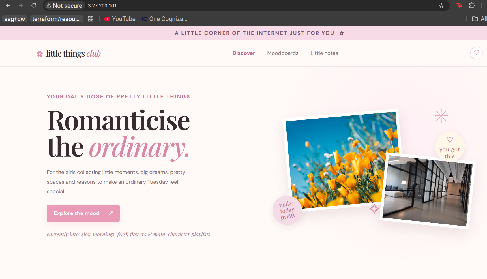
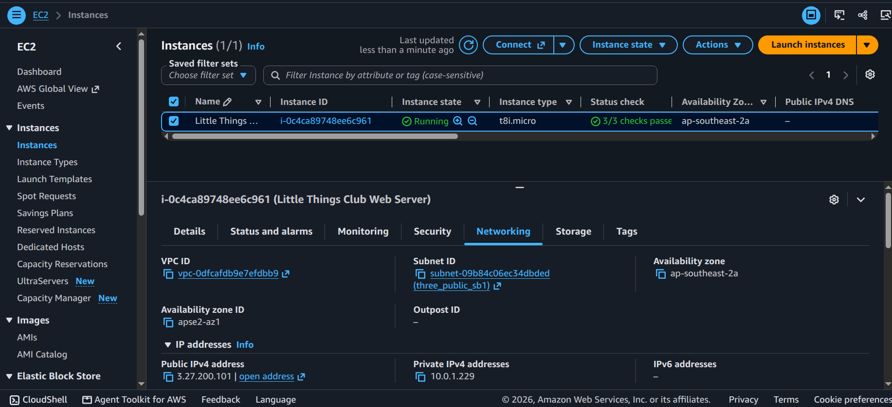
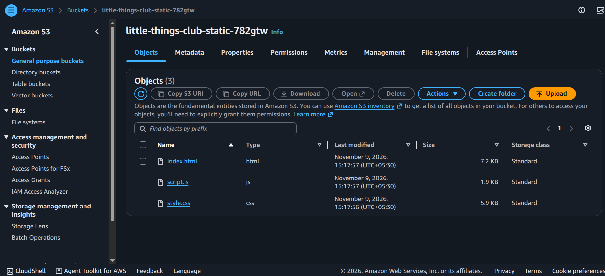
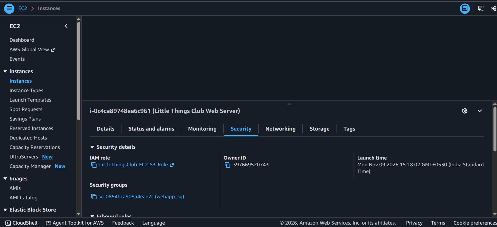

# Little Things Club Project--- Static Website Deployment on AWS

A small-scale AWS project that deploys a static website from a **private
Amazon S3 bucket** to an **Ubuntu EC2 instance**, serves it with
**Nginx**, and uses **k6** to load-test the website.

## Architecture

``` text
                 Website visitors
                        |
                        | HTTP :80
                        v
                 EC2 Public IPv4
                        |
                        v
                      Nginx
                        |
                        v
                  /var/www/html
                        ^
                        |
              aws s3 sync (AWS CLI)
                        |
                        v
                Private Amazon S3
                        ^
                        |
               EC2 IAM instance role
```

The browser connects to Nginx on EC2. The browser does **not** connect
directly to S3. EC2 retrieves the website files from S3 using its
attached IAM instance profile and serves the files locally.

## AWS services and tools

-   **Amazon EC2** --- Ubuntu virtual machine hosting the website.
-   **Amazon S3** --- Private storage for HTML, CSS, JavaScript and
    static assets.
-   **AWS IAM** --- EC2 instance role with limited S3 read permissions.
-   **Amazon VPC** --- VPC, public subnet, internet gateway and public
    route table.
-   **Security groups** --- Control inbound access to the instance.
-   **Nginx** --- Serves the downloaded static website.
-   **Terraform** --- Provisions the AWS infrastructure.
-   **AWS CLI** --- Synchronizes files from S3 to the EC2 filesystem.
-   **k6** --- Generates HTTP load against the website.

## Request and deployment flow

1.  Terraform provisions the VPC networking, security group, S3 bucket,
    IAM role and instance profile, and EC2 instance.
2.  Website files are uploaded to the private S3 bucket.
3.  EC2 assumes its IAM role through the instance profile.
4.  AWS CLI downloads the objects from S3 into `/var/www/html`.
5.  Nginx serves the local files over HTTP on port 80.
6.  k6 sends requests to the EC2 public IPv4 address to measure
    application response times and errors.

## Security configuration

-   Keep S3 Block Public Access enabled.
-   Do not use a public bucket policy for this design.
-   Grant the EC2 role only the required `s3:ListBucket` and
    `s3:GetObject` permissions for this bucket.
-   Allow inbound HTTP (TCP 80) from `0.0.0.0/0` when the website is
    intended to be public.
-   Restrict inbound SSH (TCP 22) to your current public IP using `/32`.
-   Do not open HTTPS (TCP 443) until TLS is configured.
-   Do not store AWS access keys on the EC2 instance; use the instance
    profile.

**Important:** A public website exposes the content delivered to
visitors, including HTML, CSS, JavaScript and images. Never place
credentials, private keys or other secrets in frontend files.

## Prerequisites

-   An AWS account with permission to create the required resources.
-   Terraform installed locally.
-   AWS CLI configured locally for Terraform operations.
-   An SSH key pair or a Terraform-managed EC2 key pair.
-   A local website directory containing an `index.html` file and any
    referenced assets.
-   Ubuntu-compatible EC2 AMI and instance type available in the
    selected region.

The Terraform configuration in this project uses the AWS region
`ap-southeast-2` (Asia Pacific --- Sydney). Update it if deploying
elsewhere.

## Project structure

Example structure:

``` text
little-things-club-static-website/
├── main.tf
├── outputs.tf
├── variables.tf
├── terraform.tfvars
├── webapp/
│   ├── index.html
│   ├── css/
│   │   └── style.css
│   ├── js/
│   │   └── script.js
│   └── assets/
└── loadtest/
    └── loadtest.js
```

Adjust this tree to match the files actually present in your repository.

## Deploy infrastructure

From the directory containing the Terraform configuration:

``` bash
terraform fmt
terraform init
terraform validate
terraform plan
terraform apply
```

Review the plan before applying it. Avoid committing Terraform state,
private keys, credentials or sensitive variable files.

If Terraform creates an SSH private key locally, ensure its parent
directory exists and keep the key out of version control.

## Access the website

Get the EC2 public IP from Terraform output or the EC2 console, then
open:

``` text
http://EC2_PUBLIC_IP
```






## Verify the instance

Connect to EC2:

``` bash
ssh -i /path/to/private-key.pem ubuntu@EC2_PUBLIC_IP
```


## Load testing with k6

Install k6 using the [official installation
guide](https://grafana.com/docs/k6/latest/set-up/install-k6/).

Create `loadtest/loadtest.js`:

``` javascript
import http from 'k6/http';
import { check, sleep } from 'k6';

export const options = {
  vus: 5,
  duration: '1m',
};

export default function () {
  const response = http.get(__ENV.TARGET_URL);

  check(response, {
    'HTTP status is 200': (r) => r.status === 200,
  });

  sleep(1);
}
```

Run a small test first:

``` bash
k6 run -e TARGET_URL=http://EC2_PUBLIC_IP/ loadtest/loadtest.js
```

Increase virtual users gradually (for example, 5, then 10, then 20)
while monitoring the instance. Do not run aggressive tests against
infrastructure you do not own or have permission to test.

### Metrics to review

-   Request rate (requests per second).
-   Average response time.
-   p95 response time.
-   Failed checks and HTTP error rate.
-   EC2 CPU utilization.
-   Network throughput.

monitor how the systems/instance is performing through cloudwatch-metrics

``` bash
terraform destroy
```

Review the destroy plan before confirming. Back up anything you need
first. S3 bucket deletion may require the bucket to be empty, depending
on its configuration and contents.
